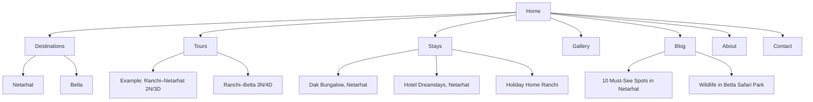

# Executive Summary

Netarhat Betla Tourism — Brand Theme
Fonts
- Headings: Playfair Display — premium, nature-inspired feel.
- Body & UI: Inter — clean, modern, readable.
Color palette
Forest Green — #124B2A
Primary brand color, header and footer
Leaf Green — #3D8B40
Secondary accents and icons
Sunset Amber — #F4A62A
Book Now buttons and highlights
Warm White — #F8F7F2
Page backgrounds and cards
Charcoal Green — #25332B
Body text and headings

Final UI direction: Premium nature tourism — warm white backgrounds, forest-green sections, large destination photography, and amber booking buttons. Keep the design spacious and uncluttered to complement the existing logo.

We propose building **Netarhat Betla Tourism** (netarhat.in) as a user‑focused, SEO‑optimized travel site modeled on best practices and inspired by the Latehar Tourism reference site.  The new site will spotlight the **Netarhat and Betla** destinations through clear navigation, concise content sections, rich visuals, and strong conversion cues (booking forms, CTAs, testimonials).  The main features include: a streamlined multi-level menu (Home; Destinations; Tours; Accommodations; Gallery; Blog; About; Contact), dedicated landing pages for each destination, a **Tour Packages** directory with individual itinerary pages, a responsive gallery of images, and a contact/booking form.  Every page will have optimized headings, meta titles/descriptions, and structured data (JSON-LD) for LocalBusiness (as a travel agency) and Tour packages (using Schema.org’s **TouristTrip**/Offer).  We recommend a URL hierarchy reflecting the taxonomy (e.g. `/destinations/netarhat`, `/tours/ranchi-netarhat-2n3d`, etc.).  Images and video assets (e.g. “netarhat_sunrise.jpg”, “betla_elephant_safari.jpg”) will be high‑quality and web‑optimized with descriptive alt text (beneficial for SEO and accessibility).  The booking flow will be clear: users select a package, view details, then submit a quick booking form or WhatsApp enquiry.  Trust signals (customer reviews, secure booking badges, local business credentials) and microcopy (helpful field prompts, confirmation messages) will reduce friction and build credibility.  We will implement Google Analytics/GA4 with event tracking (form submits, call/WhatsApp clicks, CTA taps), and Google Search Console.  If multiple domains (e.g. netarhat.co.in) are registered, they will 301‑redirect to netarhat.in to preserve SEO. 

**Table: Latehar Tourism site vs. Recommended Netarhat.in** summarizes key feature comparisons below.

| Feature                     | LateharTourism.com (Ref)                     | Recommended Netarhat.in                           |
|-----------------------------|----------------------------------------------|---------------------------------------------------|
| **Domain/Brand**            | latehartourism.com (Latehar-specific); includes broad region (multi-destinations) | netarhat.in – focused brand for Netarhat & Betla tours, .in signals Indian audience |
| **Navigation**              | Large multi-level menu with 10+ Destinations, “Traveler Essentials” submenu (packages, culture, etc) | Streamlined menu: Top-level **Home**, **Destinations** (Netarhat, Betla), **Tours/Packages**, **Stays**, **Gallery**, **Blog**, **About**, **Contact**. Fewer submenus; clear taxonomy. |
| **Destination Pages**       | Separate pages for each (Netarhat, Betla, etc.) with long prose in Hindi/English (e.g. Netarhat page has H1 “NETARHAT” and detailed text) | Dedicated destination pages (Netarhat, Betla) with concise, SEO-friendly content (not too lengthy) highlighting attractions, a photo gallery, and CTAs like “View Packages” or “Plan Your Trip”. Each page uses clear headings (H1 H2) and bullet lists (e.g. top sights, how to reach). |
| **Tour Packages (Listing)** | “Tour Packages” page lists several itineraries (2N/3D, 3N/4D, etc.) as headings with images and “View Details” links. Layout is fairly basic (stacked headings). | Organized **Packages** page: filterable cards or table of tours. Each card shows itinerary name, duration, thumbnail, summary, price range, and a “View Details” or “Book Now” button. Use an ItemList schema for listing if desired. |
| **Package Details (Itineraries)** | Detail pages (e.g. *Latehar-Netarhat-Latehar*) use headings for day-by-day itinerary and list of sights. Pricing for groups is shown in plain text (repeated lines). No booking CTA or form. | Package pages with structured layout: hero image + tour title, summary, itinerary (Day 1, Day 2… as H3/H4), list of highlights, and a clear pricing table. Include a prominent **“Book Now”** or **“Enquire”** CTA leading to a booking form or contact widget. Use schema (TouristTrip and Offer) in JSON-LD for each package (see examples below). |
| **Accommodations**          | Separate “Accommodations” menu listing Dak Bungalow, hotels, etc. Each is a page with info.   | **Stays** section listing recommended hotels (Netarhat, Betla). For each: image, name, brief description, rating icons (stars), and “Book Now” linking to booking platforms or enquiry form. Possibly embed partner booking widgets. |
| **Gallery / Media**         | Minimal gallery: homepage shows some destination images; each page uses images with poor alt text (e.g. “Netarhat (14)”).  | Dedicated **Gallery** page: high-res images/video (Netarhat sunrise, Betla wildlife) in a clean grid/lightbox. Filenames and alt text: e.g. `netarhat_sunrise_point.jpg` with alt “Sunrise view from Netarhat viewpoint”. Caption/tag each image. Use WebP or optimized JPEG (≤200 KB) for speed. |
| **CTAs & Conversion**       | Few explicit CTAs. Some “Book Now” links on hotel images, but booking ultimately via phone/WhatsApp. Contact page shows phone, email but no form. No obvious testimonials or trust badges. | Prominent CTAs: “Book Tour”, “Request Callback”, “Enquire Now” on every package and destination page. Use sticky or header buttons (e.g. WhatsApp contact icon). Add testimonials (slider on homepage) like “I really enjoyed my stay…”. Display awards or certifications (“Jharkhand Govt. Approved Operator”). Trust signals: highlight 24/7 support, safety protocols, money-back guarantee, etc. |
| **Metadata & SEO**         | Largely auto-generated or missing meta tags. Titles are generic (“Latehar Tourism® – Official website”) and descriptions echo page text. No Schema markup.  | Each page gets a unique `<title>` and `<meta name="description">` following Google’s SEO guide: titles concise, include key terms and location; descriptions ~150–160 chars, unique and summary of content. Implement JSON-LD structured data (see below). Use breadcrumb schema to reflect nav hierarchy. Optimize H-tags (one H1 per page, clear H2/H3 sections). Mobile-first design and fast load speed (compress images, lazy‑load). |
| **Trust & Credibility**     | Limited. Only contact info and “Developed by” note in footer. No reviews or secure logos.  | Enhance trust: Add customer reviews (with star ratings schema), partner logos (e.g. “Member of TAAI” badge), SSL certificate icon, and privacy policy/terms links. Security seals on booking form (if payments). Institutional links (Govt tourism site link) can bolster legitimacy. |
| **Form & Booking Flow**     | No integrated booking form. A complex “Book Car Online” form exists under Transportation, with many fields. Users must manually message/phone. | Simplify booking: On each package page, include a one-page **Booking Form** (name, email, phone, dates, guests, package). Keep fields minimal (see [30†L112-L119]) and use placeholders (“Name”, “Email”). After submit, show confirmation or send direct WhatsApp link. Alternatively, enable online payments integration (e.g. Razorpay). Provide a progress indicator if multi-step. |
| **Analytics/Tracking**      | Unknown (likely minimal; no visible analytics script).   | Implement Google Analytics 4 and Google Tag Manager. Track form submissions, CTA clicks, phone/WhatsApp clicks as conversion events. Enable Google Search Console (site map XML). Set up goals (e.g. “Book Now”). Integrate Facebook Pixel / remarketing tags. Use dataLayer for dynamic events (pageview category as travel pages). Provide a cookie consent banner if required.  |
| **Migration / Redirects**   | N/A for Latehar (existing .com).    | If multiple domains (.co.in, .org) are obtained, 301‑redirect all to `netarhat.in` to consolidate SEO equity. Use canonical URLs (`rel="canonical"`) where needed. Submit updated sitemap to Search Console after launch. Configure backup domains in Google Webmaster Tools (Change of Address if migrating from old domain). |

## Site Map (Navigation Structure)

The proposed information architecture is:

- **Home** – Hero, intro, featured tours, testimonials, highlights
- **Destinations**
  - **Netarhat** – overview, attractions, photos, booking CTA
  - **Betla** – overview, attractions, photos, booking CTA
- **Tours (Packages)** – listing of all tour packages
  - *(Individual Tour pages)* – detailed itinerary, pricing, booking form
- **Stays** – accommodations list in Netarhat/Betla (with booking links)
- **Gallery** – photo/video gallery of Netarhat & Betla
- **Blog / News** – travel articles, news, tips
- **About Us** – company info (as a LocalTour operator)
- **Contact** – contact form, contact info, map

Mermaid diagram of the site map:



## Page-by-Page Content Inventory

Below is an outline of each page’s content plan, including headings, copy points, CTAs, media, and SEO metadata.  (Titles and meta descriptions are draft examples following Google’s guidelines.)

### 1. Home (`/`)

- **Headings:** 
  - H1: *Netarhat Betla Tourism* 
  - Subheadline (hero): *“Discover Jharkhand’s Hidden Gems”* or similar. 
  - H2: Featured Tours / Our Packages, Highlights, Testimonials, or Why Choose Us.
- **Copy:** Brief intro to region (“Explore the misty hills of Netarhat and the wild forests of Betla…”). Two or three key selling points (natural beauty, wildlife safaris, expert guides). Keep text scannable with bullet highlights.
- **CTA:** “Explore Tours” (scroll to tours section), “Contact Us” (scroll to contact), or a “Book Now” overlay button on the hero. Make phone/WhatsApp icon always visible (e.g. in top-right).
- **Media:** Full-width hero image slider (sunrise at Netarhat, elephants in Betla). Below, 3–4 icon blocks or images showcasing highlights (sunrise point, Palamau fort, etc.). Customer testimonial carousel (e.g. “Amazing experience…”).
- **SEO (example):** 
  - Title: “Netarhat Betla Tourism – Netarhat & Betla Tour Packages, Jharkhand” 
  - Meta: “Netarhat Betla Tourism offers guided tours to Netarhat (sunrise point) and Betla (safari park). Book hiking & wildlife packages in Jharkhand. Plan your trip today!”.

### 2. Destination – Netarhat (`/destinations/netarhat`)

- **Headings:** 
  - H1: *Netarhat, Jharkhand* (the “Queen of Chotanagpur”) 
  - H2: “Highlights” (sunrise, sunset, viewpoints, heritage school) 
  - H2: “How to Reach” / Travel Info.
- **Copy:** 1–2 paragraphs on Netarhat’s appeal (elevation 1128m, pine forests, beautiful sunsets). List key attractions with H3’s or bullets (e.g. *Sunrise Point*, *Magnolia Point*, *Upper Ghaghri Falls*, *Netarhat School*). Each can have 1–2 lines description. 
- **CTA:** “See Tours to Netarhat” (link to tours that include Netarhat); “View Gallery”.
- **Media:** A slideshow of Netarhat images (sunrise, pine forest, falls) with alt text like *“Sunrise over Netarhat viewpoint”*. Possibly embed a short video clip if available.
- **SEO:** 
  - Title: “Netarhat Tourism – Things to Do & See | Netarhat Betla Tourism” 
  - Meta: “Netarhat in Jharkhand offers misty hills, stunning sunrises and pine forests. Browse top tours to Netarhat and book Netarhat safari/trek packages.”.

### 3. Destination – Betla (`/destinations/betla`)

- **Headings:** 
  - H1: *Betla, Jharkhand* 
  - H2: “Highlights” (Betla National Park, Palamau Forts) 
  - H2: “How to Reach”.
- **Copy:** Description (Betla ~170km from Ranchi, gateway to Palamau Tiger Reserve). Mention safari rides on elephants, jeep safaris, and historic forts. Include wildlife types (bison, deer) and example attractors (baby elephant “Rakhi”). 
- **CTA:** “See Tours to Betla”; “Wildlife Safari Packages”.
- **Media:** Photos of Betla (elephants, Palamau Fort, etc.), alt like *“Elephants in Betla National Park”*.
- **SEO:** 
  - Title: “Betla Tourism – Safari & Attractions | Netarhat Betla Tourism” 
  - Meta: “Explore Betla in Jharkhand – home to Palamau Tiger Reserve, elephant safaris & Palamau Forts. Find Betla tour packages and wildlife adventures.”.

### 4. Tour Packages (`/tours` or `/packages`)

- **Headings:** 
  - H1: *Tour Packages* 
  - H2: “Tour Itineraries” or “Our Tours from Ranchi” (if focused on Ranchi departures).
- **Copy:** Intro blurb (“Choose from our curated tours. All tours include hotels, meals, and transport.”). Possibly highlight best sellers.
- **Layout:** Responsive grid or list of package cards. Each card: image, title (e.g. “Ranchi – Netarhat – Ranchi”), duration (2N/3D), short summary, starting price, and “View Details” button.
- **CTA:** “View Details” (or “Book Now”) on each card.
- **Media:** Thumbnail images for each tour (Netarhat viewpoint, Betla safari).
- **SEO:** 
  - Title: “Jharkhand Tour Packages (Netarhat, Betla) – 2N/3D, 3N/4D” 
  - Meta: “Browse our Netarhat and Betla tour packages (2–7 days). See itineraries, prices, and inclusions (hotels + transport). Book your tour today!”.

### 5. Individual Tour Detail (e.g. `/tours/ranchi-netarhat-ranchi-2n3d`)

- **Headings:** 
  - H1: “Ranchi – Netarhat – Ranchi (2N/3D)” (the tour name). 
  - H2: *Itinerary* – then H3’s for “Day 1”, “Day 2”, etc. 
- **Copy:** 
  - **Itinerary:** For each day, bullet the key stops (e.g. Day 1: travel to Netarhat, witness sunrise, visit Upper Ghaghri, Lodh Falls; Day 2: visit Koel Viewpoint, Pine Forest, Netarhat School, return, etc).  
  - **Inclusions/Exclusions:** short list or table (e.g. “Included: hotel (2 nights), meals, SUV transport; Excluded: flights, park fees”). 
  - **Pricing:** Table of per-person prices by group size (e.g. “2 pax: ₹15,999; 4 pax: ₹20,999” etc). 
- **CTA:** Prominent “Book This Tour” button linking to a booking form (on same page or popup). Also “Enquire on WhatsApp” link.
- **Media:** Large header image of Netarhat or tour montage. Possibly a small carousel of photos of sites visited. Alt text e.g. *“Group at Magnolia Sunset Point”*. 
- **SEO:** 
  - Title: “Ranchi–Netarhat Tour Package (2N/3D) | Netarhat Betla Tourism” 
  - Meta: “Itinerary: Ranchi to Netarhat and back in 3 days (sunrise, falls, forests). Includes deluxe hotel and cab. Starting ₹15,999/pax. Book now!”.

### 6. Accommodations (`/stays`)

- **Headings:** 
  - H1: *Recommended Accommodations* 
- **Copy:** Intro (“Comfortable stays in Netarhat and Ranchi for our tour guests.”). 
- **Layout:** Cards or list of hotels with images, name, brief description, star rating icons. For each: link button “Book on [HotelSite]” or “Check Availability” (if affiliate). 
- **CTA:** “Book” or “More Info” on each listing.
- **Media:** Hotel photos (dak bunglow Netarhat, holiday home, etc.) with alt text “Dak Bungalow Netarhat – exterior view”.
- **SEO:** 
  - Title: “Netarhat and Jharkhand Hotels – Netarhat Betla Tourism” 
  - Meta: “Stay in comfort at our partner hotels in Netarhat. Deluxe rooms with breakfast included. Book your Netarhat hotel or holiday home in Ranchi.”.

### 7. Gallery (`/gallery`)

- **Headings:** 
  - H1: *Photo & Video Gallery* 
  - H2 (optional): “Netarhat Collection”, “Betla Collection”.
- **Content:** Grid of images (e.g. 3 or 4 columns). Each image lightboxes when clicked. Brief captions under or on hover (“Netarhat Sunrise Point”). Possibly embed a YouTube video (e.g. aerial drone of Netarhat). 
- **Media Names/Alt:** e.g. `netarhat_sunrise.jpg` alt *“Sunrise at Netarhat viewpoint”*; `betla_forest.jpg` alt *“Dense jungle of Betla forest”*. 
- **SEO:** 
  - Title: “Netarhat & Betla Photo Gallery – Netarhat Betla Tourism” 
  - Meta: “Browse images of Netarhat hills, Betla wildlife safaris, and more. See what to expect on your Netarhat trip.”.

### 8. Blog / News (`/blog` and `/blog/post-name`)

- **Headings:** 
  - H1 (Blog list): *Insights & Travel Tips* 
  - H2 (post): Article titles.
- **Content:** Example posts: “Top 5 Things to Do in Netarhat”, “Wildlife Safari Tips for Betla”. List view: featured image + excerpt + “Read More”. Individual post: content with subheadings, images, outbound links to sources. 
- **CTA:** “Subscribe” or newsletter signup, social share buttons.
- **SEO:** Titles unique per post, meta descriptions summarizing article. Use `BlogPosting` schema (optional).

### 9. About Us (`/about`)

- **Headings:** 
  - H1: *About Netarhat Betla Tourism* 
- **Copy:** Company mission (promote eco-tourism in Jharkhand), team credentials. Brief region context. Possibly mention partnership with Jharkhand Tourism Dept. 
- **CTA:** Link to Contact/Packages.
- **Media:** Photo of team or Netarhat landscape.
- **SEO:** 
  - Title: “About Us – Netarhat Betla Tourism” 
  - Meta: “Netarhat Betla Tourism is an eco-tour operator based in Jharkhand, specializing in guided tours to Netarhat and Betla.”.

### 10. Contact (`/contact`)

- **Headings:** 
  - H1: *Get In Touch* 
  - H2: *Contact Us / Enquire* 
- **Content:** Brief intro (e.g. “Questions? We’re here to help.”). 
- **Contact Info:** Phone, email, office address (with Google Map embed), social icons. 
- **Form:** Name, Email, Phone, Message fields and **Submit** button. Add a checkbox for “Subscribe to newsletter”. 
- **Testimonial:** Possibly a short quote/slider (“Our guests love their Netarhat tours!”). 
- **Trust:** Display any industry certifications or review badges. 
- **SEO:** 
  - Title: “Contact – Netarhat Betla Tourism” 
  - Meta: “Have questions? Contact Netarhat Betla Tourism for tour bookings, inquiries or assistance. Call or email us.”.

## Wireframe Layout Suggestions

For each key page, we suggest a clean, responsive layout:

- **Homepage:** Full-width header with logo, nav, and prominent Call–To–Action (CTA) (e.g. WhatsApp icon or “Book Now”). Hero banner image (Netarhat sunrise) with overlay title/text and “Explore Tours” button. Below, a 3‑column section highlighting Netarhat, Betla, and “Why Choose Us” (with icon/image and short text). Next, a **Featured Packages** section showing 2–3 tour cards side by side. Include a **Testimonials** carousel (customer quote + 5-star rating). Finally, an email signup/CTA (“Plan Your Trip Today”) and footer (contact info, social links) across the bottom.

- **Packages Listing:** Header and H1, optional filter bar (e.g. by duration or destination). Grid of package cards: image thumbnail on top, below it package title (H3), short blurb (1–2 lines), price or “Starting at ₹…”, and a “View Details” button. Example (2- or 3-column grid). 

- **Package Detail:** Page header with tour name and duration. Then a two-column layout: left side text (H2 Itinerary, list of Day1/Day2), right side image carousel or map. Alternatively, single column for simplicity: image carousel at top, followed by itinerary text with subheadings. Below itinerary, a **Pricing & Booking** box (highlight box) showing table of prices (2 pax,4 pax etc) and a “Book Now” CTA. Show “What’s Included/Excluded” bullet list below that. 

- **Booking Form:** Could be a stand-alone page or integrated at bottom of package detail. Use step-by-step or anchored scroll. E.g., “Step 1: Select Dates/People”, “Step 2: Enter Details”. Keep fields minimal (Name, Contact, Travel Dates, #Guests, Special Requests). Each field with clear label and placeholder (e.g. “Your Full Name”). Display a summary (selected tour, price) on side. Include privacy notice (“We respect your privacy”) near submit.

- **Gallery:** Masonry grid (Pinterest-like) of photos. Clicking any opens full image overlay with caption. Optionally tabs “Netarhat” and “Betla” to filter images by location. Include video thumbnails with play icon (click to embed/pop-out video).

- **Blog List:** Sidebar or header with categories/tags filter. Each post preview has image, title, date, excerpt, and “Read More”. Use standard blog layout (one or two columns).

- **Contact:** Simple two-column: left column a contact form (as above), right column shows address, phone, email, and an embedded Google Map. Above form, include a heading “Drop us a message” and note typical response time (“We reply within 24 hours”).

*UX note:* Throughout, use clear microcopy (e.g. field labels like “Preferred Travel Dates”), avoid jargon, and ensure CTAs stand out (buttons in a contrasting color). All pages include a breadcrumb trail (Home > Section > Page) for easy navigation and schema (`BreadcrumbList`).

## Information Architecture & URL Structure

**Taxonomy and URLs:** We recommend grouping content by **Destinations**, **Tours**, and **Stays**, with clear hierarchical URLs:

- **Destinations:** netarhat.in/destinations/netarhat/, netarhat.in/destinations/betla/ (and possibly other nearby sites in future). Use descriptive slugs (lowercase, hyphens).  
- **Tours/Packages:** netarhat.in/tours/ for the listing page. Individual tours: netarhat.in/tours/ranchi-netarhat-2n3d/ or similar. (Ensure the slug reflects the itinerary and duration, e.g. “ranchi-netarhat-3n4d”.)  
- **Accommodations:** netarhat.in/stays/ or /accommodations/. Subpages (if needed) like /stays/dak-bungalow-netarhat.  
- **Gallery:** netarhat.in/gallery/.  
- **Blog:** netarhat.in/blog/ and posts netarhat.in/blog/post-title-here (hyphenated).  
- **About:** netarhat.in/about/.  
- **Contact:** netarhat.in/contact/.  

This clean structure mirrors best practices for SEO-friendly URLs (short, logical). We will use breadcrumb schema so Google can show site hierarchy in results. All pages should link internally with descriptive anchor text to strengthen crawlability.

## SEO & Schema Recommendations

- **Metadata:** Write unique `<title>` tags and meta descriptions for every page. Titles should follow Google’s advice: unique, concise, and include keywords/location (e.g. “Netarhat Safari Tours – Jharkhand Trip Packages”). Meta descriptions should be ~150–160 characters, one or two sentences summarizing the page, including a call-to-action or key highlight. Avoid duplicate metadata.

- **Header Tags:** Use one H1 per page (as outlined above). Use H2/H3 for subheadings (itineraries, sections). This helps both users and SEO crawlers understand structure.

- **Structured Data (JSON-LD):** Implement JSON-LD using schema.org vocabulary for:

  - **LocalBusiness/TravelAgency:** Mark up the business info on the homepage or Contact page. E.g.:
    ```html
    <script type="application/ld+json">
    {
      "@context": "https://schema.org",
      "@type": "TravelAgency",
      "name": "Netarhat Betla Tourism",
      "image": "https://netarhat.in/assets/logo.png",
      "address": {
        "@type": "PostalAddress",
        "streetAddress": "Railway Station Road",
        "addressLocality": "Latehar",
        "addressRegion": "Jharkhand",
        "postalCode": "829207",
        "addressCountry": "IN"
      },
      "telephone": "+916205087480",
      "email": "info@netarhat.in",
      "url": "https://netarhat.in",
      "openingHours": "Mo-Su 09:00-18:00",
      "description": "Netarhat Betla Tourism offers guided tours and packages in Jharkhand’s Netarhat and Betla regions."
    }
    </script>
    ```
    This uses schema.org’s `TravelAgency` (a subtype of LocalBusiness). It should be placed in the head or footer. Google Search recommends JSON-LD format. 

  - **Tour Packages:** Use schema.org’s **TouristTrip** or **TouristDestination** types (as recently introduced). For each tour page, embed JSON-LD with the itinerary, provider, and an `offers` section for pricing. Example snippet:
    ```html
    <script type="application/ld+json">
    {
      "@context": "https://schema.org",
      "@type": "TouristTrip",
      "name": "Ranchi–Netarhat Tour Package (2N/3D)",
      "description": "A 3-day guided tour from Ranchi to Netarhat, including sunrise and sunset points, waterfalls, and forest safari.",
      "touristType": "Nature Lovers",
      "itinerary": {
        "@type": "ItemList",
        "itemListElement": [
          {
            "@type": "ListItem",
            "position": 1,
            "item": {
              "@type": "Place",
              "name": "Kathautia Dam"
            }
          },
          {
            "@type": "ListItem",
            "position": 2,
            "item": {
              "@type": "Place",
              "name": "Upper Ghaghri Falls"
            }
          }
        ]
      },
      "provider": {
        "@type": "TravelAgency",
        "name": "Netarhat Betla Tourism"
      },
      "offers": {
        "@type": "Offer",
        "price": "15399",
        "priceCurrency": "INR",
        "availability": "https://schema.org/InStock"
      }
    }
    </script>
    ```
    This follows schema.org definitions. Ensure required fields (`name`, `itinerary`, `offers`, etc.) are included. Use the Rich Results Test to validate markup.

- **Other Markup:** Optionally add `BreadcrumbList` for the nav path, and `Review`/`AggregateRating` if collecting customer reviews (to show star ratings in Google results). For any hotel listings, use `LodgingBusiness` schema.

- **Performance & Mobile:** Optimize images (use WebP, proper dimensions) and minify CSS/JS. Ensure site is mobile-responsive – a must for travel sites. Google’s Core Web Vitals should be targeted (fast load times for images and scripts). The responsive design also supports SEO (mobile-first indexing).

- **Content Quality:** Write all content for users (human-friendly and well-structured). Avoid hidden text or keyword stuffing; Google values helpful, people-first content. Use internal links (e.g. link “Learn more about Netarhat” to the Netarhat page) to improve crawlability and context.

## UX & Conversion Optimization

- **Forms & Microcopy:** Keep forms short. Label fields clearly (“Name *”, “Email *”, “Travel Date”). Use inline hints (“dd/mm/yyyy”) and error messages (“Please enter a valid email”). Include privacy microcopy (“We’ll never share your info”). Make submit buttons descriptive (“Enquire Now”, “Confirm Booking”). Provide immediate feedback after submit (“Thank you! We will contact you within 1 business day.”).

- **Calls to Action:** Use action-oriented language. For example, “Plan Your Netarhat Adventure” or “Join a Betla Safari”. Buttons should contrast with site colors. Place CTAs prominently (top hero, end of package details, sticky header). A floating WhatsApp chat widget can greatly improve conversions (since the reference site already uses WhatsApp link).

- **Trust Signals:** Show at least 2–3 customer testimonials with photos or names. Display partner logos (Jharkhand Tourism Dept), payment security icons, and business registration numbers if applicable. If possible, integrate Google or Facebook review snippets. On booking pages, include a small “SSL secured” badge or SSL padlock in the browser bar for reassurance.

- **Accessible Navigation:** Ensure menus and buttons are large enough on mobile. Use clear hover/focus states. The booking flow should require minimal typing (e.g. use date pickers, dropdown for number of guests). Progressively reveal fields (after user selects a tour, then show date, etc.) to avoid overwhelming the user.

- **Consistency:** Keep a consistent color scheme and branding (logo on all pages, consistent fonts). The Latehar site’s cluttered style can be improved by whitespace and grid alignment.

## Image/Video Asset Guidelines

- **Quality:** Use high-resolution, professional images showcasing attractions (sunrise at Magnolia Point, Betla elephants, etc.). If possible, hire a photographer or license good stock photos of Netarhat/Betla. Limit each image’s file size (e.g. 1920×1080 at ~150KB after compression) to balance quality and load speed.

- **Formats:** Use modern formats (WebP) for browsers that support it, with JPEG fallback. For social sharing (Open Graph), use square or 1200×630 images.

- **Filenames/Alt Text:** Name image files descriptively: e.g. `netarhat_sunrise_point.jpg`, `betla_elephant_safari.jpg`, `palamau_fort.jpg`. For alt text, describe the scene rather than generic labels (avoid “image of” or “photo of” prefix). Example alt texts:
  - *“Sunrise over Magnolia Point, Netarhat”*  
  - *“Tigers in Palamau Sanctuary, Betla National Park”*  
  - *“Historic Palamau Fort ruins”*  
  Good alt text boosts accessibility and can improve image SEO (Google indexes images by alt text, and users often find travel sites via image search).

- **Videos:** If including videos (like a tour montage), host on YouTube/Vimeo and embed to save bandwidth. Provide a transcript or captions for accessibility and keyword context.

## Analytics & Tracking

- **Google Analytics 4:** Install GA4 code (via gtag.js or Tag Manager) on all pages. Define conversion events:
  1. **Form Submission:** When the contact/booking form is submitted.  
  2. **CTA Clicks:** Track “Book Now” and “WhatsApp Chat” clicks.  
  3. **Outbound Clicks:** If linking to hotel partners.  
  4. **Phone Clicks:** Track clicks on the phone link.  
- **Google Tag Manager:** Use GTM to manage scripts and events without code changes. 
- **Search Console:** Set up netarhat.in in Google Search Console; submit an XML sitemap (updated regularly as content is added). Monitor crawl errors and search analytics.
- **Heatmaps/Funnels:** Optionally use tools like Hotjar or Microsoft Clarity to analyze where users click or drop off. 
- **Privacy:** Include a cookie consent banner (e.g. for Analytics) to comply with regulations.

## Migration/Redirect Plan

If netarhat.in is a new domain, minimal migration is needed. However, if you acquire related domains (e.g. netarhattrip.in, netarhat.co.in), set up permanent (301) redirects from those to netarhat.in. Similarly, if transferring content from an old site, redirect old URLs to new equivalents. This ensures Google and users always end up on netarhat.in.  Use Google’s “Change of Address” tool in Search Console if moving from another domain. Ensure any internal links and sitemaps point to the final .in domain. By redirecting “non-preferred URLs to the one that best represents the information” as Google advises, you preserve SEO value and avoid duplicate content issues.

Throughout development, follow SEO best practices (fast load, mobile-friendly) and regularly validate structured data (Rich Results Test) and perform SEO audits. This plan combines lessons from the LateharTourism site with official guidelines to create a comprehensive, conversion-oriented travel website for Netarhat & Betla. 

**Mermaid Diagrams:** The site map above shows the navigation tree. A sample **booking flow** could be:

```mermaid
flowchart LR
  A[Home Page] --> B[Tour Packages Page]
  B --> C[Specific Tour Page]
  C --> D[User Clicks "Book Now"]
  D --> E[Booking Form (Name, Date, Guests)]
  E --> F[Confirmation / Thank You Page]
```

**Structured Data Snippets:** (Insert as `<script type="application/ld+json">` in HTML)

- **TouristTrip (Example tour):**  

```json
{
  "@context": "https://schema.org",
  "@type": "TouristTrip",
  "name": "Ranchi–Netarhat Tour (2N/3D)",
  "description": "Guided tour from Ranchi to Netarhat and back, including sunrise/sunset points and waterfalls.",
  "touristType": "Sightseeing",
  "itinerary": {
    "@type": "ItemList",
    "itemListElement": [
      {
        "@type": "ListItem",
        "position": 1,
        "item": {
          "@type": "Place",
          "name": "Kathautia Dam"
        }
      },
      {
        "@type": "ListItem",
        "position": 2,
        "item": {
          "@type": "Place",
          "name": "Upper Ghaghri Waterfall"
        }
      }
    ]
  },
  "provider": {
    "@type": "TravelAgency",
    "name": "Netarhat Betla Tourism"
  },
  "offers": {
    "@type": "Offer",
    "price": "15399",
    "priceCurrency": "INR",
    "availability": "https://schema.org/InStock"
  }
}
```

- **LocalBusiness (Travel Agency):**

```json
{
  "@context": "https://schema.org",
  "@type": "TravelAgency",
  "name": "Netarhat Betla Tourism",
  "image": "https://netarhat.in/images/logo.png",
  "address": {
    "@type": "PostalAddress",
    "streetAddress": "Railway Station Road",
    "addressLocality": "Latehar",
    "addressRegion": "Jharkhand",
    "postalCode": "829207",
    "addressCountry": "IN"
  },
  "geo": {
    "@type": "GeoCoordinates",
    "latitude": 23.7367,
    "longitude": 84.4197
  },
  "url": "https://netarhat.in",
  "telephone": "+916205087480",
  "email": "info@netarhat.in",
  "openingHours": "Mo-Su 08:00-20:00",
  "priceRange": "$$",
  "description": "Eco-tour operator offering Netarhat & Betla tours in Jharkhand.",
  "sameAs": [
    "https://www.facebook.com/NetarhatBetlaTourism",
    "https://www.instagram.com/netarhatbetlatourism"
  ]
}
```

These snippets (wrapped in `<script>` tags) follow Google’s structured data guidelines and help search engines display rich results.  

**Sources:** Site content and navigation were analyzed from Latehar Tourism. SEO/schema best practices are drawn from Google’s documentation and schema.org definitions. The comparison highlights improvements (clear structure, CTAs, forms, metadata) over the reference site’s approach.